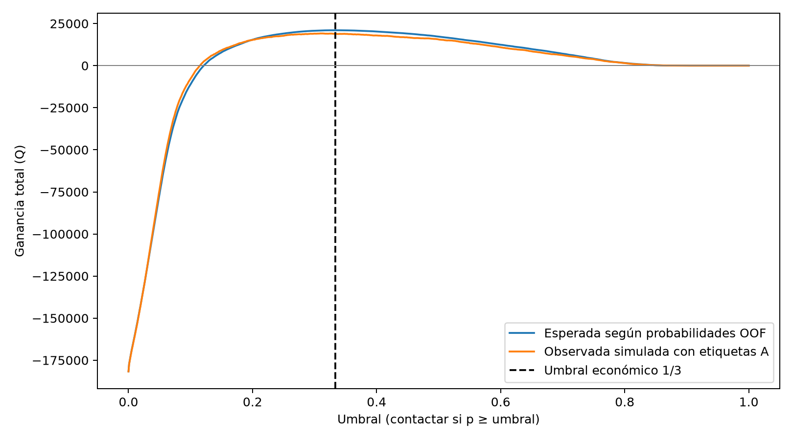

# Cierre académico y técnico de Fase 2.2

## Resultado definitivo y objetivo

La política económica congelada se evaluó una sola vez en B. El test finalizó
correctamente el **2026-11-11 a las 20:32:33.890840 UTC**. El intento está consumido:
**no repetir exportación ni evaluación; no reajustar modelo, calibración o umbral**.
Este informe documenta resultados existentes, sin nuevos experimentos.

El objetivo de 2.2 es justificar la decisión de contacto con validación cruzada de A,
reentrenar con todo A y medir una única vez su desempeño y ganancia simulada en B.
La rúbrica original se usa conforme a la transcripción proporcionada por el usuario;
este cierre no representa aprobación docente ni asignación de una nota.

## Cortes y modelo

| Elemento | Especificación |
|---|---|
| A | Corte 2026-07-01; 60,664 personas, 8,110 positivos; prevalencia 13.3687%. |
| B | Corte 2026-07-31; 59,126 personas, 7,261 positivos; prevalencia 12.2806%, derivada de agregados. |
| Ventana de características B | [2026-07-03, 2026-07-31). |
| Ventana de etiqueta B | [2026-07-31, 2026-08-30). |
| Convención temporal | Intervalos semiabiertos y relojes de las fuentes existentes; Aerómetro posterior equivale a [2026-07-31 06:00 UTC, 2026-08-30 06:00 UTC). No se afirma UTC uniforme para todas las fuentes. |
| Modelo | Regresión logística L1, lambda=1, C=1; nueve características y preprocesamiento de 1.4 congelados. |
| Validación A | Cinco folds estratificados, shuffle=True, semilla 42; imputación, escalado y codificación ajustados solo con train de cada fold. |
| Modelo final | Pipeline nuevo ajustado con todo A, 60,664 observaciones, antes de acceder al test. |
| Decisión | Contactar si p >= 1/3 exacto; sin recalibración ni selección con B. |

Las etiquetas corresponden a ausencia de actividad registrada bajo la definición
existente. No se cambian elegibilidad, etiquetas, SQL ni ventanas para este cierre.

## Derivación económica y decisión usando A

El contacto cuesta Q5, la retención condicional de quien abandonaría es 25% y el
valor de una retención es Q60. Suponiendo beneficio incremental nulo en no
abandonantes, costos/valores constantes y capacidad sin límite:

```text
G(contactar | p) = p × 0.25 × Q60 − Q5 = Q(15p − 5)
G(no contactar) = Q0
15p − 5 >= 0  =>  p >= 5/15 = 1/3
```

En el empate se contacta y la ganancia esperada es cero. El umbral se almacena como
fracción 1/3; 33.33% es solo una presentación redondeada.

La cuenta económica fija el candidato 1/3 y la validación OOF de A respalda su
adopción frente a políticas alternativas. No se afirma que se eligiera el máximo
empírico de una búsqueda de umbral. La selección histórica L1 C=1 usó el mismo CV;
los resultados OOF no son una evaluación externa independiente de esa selección.



La figura existente distingue ganancia esperada OOF y observada simulada con
etiquetas A; la línea discontinua marca 1/3. Su procedencia se contrastó con la
configuración A y el código generador, sin ejecutarlo ni regenerar la gráfica.
La curva es descriptiva, no una búsqueda posterior sobre B.

| Política A OOF | Contactados | Ganancia esperada | Observada simulada |
|---|---:|---:|---:|
| No contactar | 0 | Q0.00 | Q0.00 |
| Contactar todos | 60,664 | -Q181,638.37 | -Q181,670.00 |
| Umbral 0.5 | 3,732 | Q17,243.89 | Q15,585.00 |
| Umbral 1/3 | 7,019 | Q21,013.94 | Q18,875.00 |

Fuentes agregadas: [curva A](../../reportes_fase2_2/curva_ganancia.csv),
[comparación de políticas](../../reportes_fase2_2/comparacion_politicas.csv) y
[métricas OOF](../../reportes_fase2_2/metricas_oof.csv).
La comparación siguiente usa OOF agrupada, distinta de la media de AP por fold.

## Evaluación única B y trazabilidad

| Evidencia temporal | UTC real registrada |
|---|---|
| Reserva exclusiva del test | 2026-11-11T20:32:27.890844+00:00 |
| Evento previo a lectura B | 2026-11-11T20:32:33.650308+00:00 |
| Fecha del resultado agregado | 2026-11-11T20:32:33.828262+00:00 |
| FINALIZADO / EJECUTADO | 2026-11-11T20:32:33.890840+00:00 |

**Commit usado para ejecutar:** `931146e26c0dec88ec374bd2b8015c185fdaf90f`.
Este documento es posterior a esa ejecución; cualquier commit documental futuro
será otro hito y no sustituirá el commit ni la fecha del test.

El operador comunicó salida exitosa y código 0. La auditoría privada verificó reserva,
ajuste completo de A, evento anterior al acceso y FINALIZADO con hash del resultado.
El mecanismo de creación exclusiva y los artefactos existentes impiden otra ejecución
local normal; no proporcionan bloqueo distribuido ni protección contra borrado manual.
Conservarlos sin alterar. No se publican autorizaciones, reservas ni bitácoras privadas.
El evaluador no genera un manifiesto separado del test: sus evidencias son resultado
agregado y bitácora; el manifiesto de exportación es un artefacto anterior y distinto.

## Matriz de confusión y métricas B

| Real / decisión | Contactar | No contactar |
|---|---:|---:|
| Positivo | TP = 3,107 | FN = 4,154 |
| Negativo | FP = 3,249 | TN = 48,616 |

Total: 59,126; positivos: 7,261; contactados: 6,356. Los conteos se reconcilian.

| Métrica | Resultado B |
|---|---:|
| Precisión | 0.488829 |
| Recall | 0.427902 |
| F1, derivado de matriz agregada | 0.456341 |
| Average precision (AP) | 0.440916 |
| ROC-AUC | 0.847482 |
| Brier | 0.085068 |
| Log-loss | 0.281870 |
| ECE | No registrado; no reconstruido. |

F1 = 2TP / (2TP + FP + FN). No se usan datos individuales para esta derivación.
La copia exacta [resultado_test_b.agregado.json](resultado_test_b.agregado.json)
conserva la precisión numérica original; el informe redondea solo la presentación.

## Ganancia B y comparación con validación

```text
G_B = 0.25 × 60 × TP − 5 × (TP + FP)
    = 10 × 3107 − 5 × 3249
    = Q31,070 − Q16,245 = Q14,825.00
```

La ganancia esperada registrada, suma de (15p − 5) entre contactados, es
**Q18,504.75**. Se transcribe el agregado existente, sin recuperar scores ni recalcular
predicciones. La ganancia observada simulada es **Q14,825.00**: usa etiquetas y
retención hipotética del 25%; no mide beneficio causal ni retenciones realizadas.

| Indicador | A OOF | B único |
|---|---:|---:|
| Personas | 60,664 | 59,126 |
| Prevalencia | 13.3687% | 12.2806% |
| AP | 0.482160 | 0.440916 |
| Precisión | 0.512609 | 0.488829 |
| Recall | 0.443650 | 0.427902 |
| Brier | 0.089065 | 0.085068 |
| Log-loss | 0.296666 | 0.281870 |
| Ganancia esperada | Q21,013.94 | Q18,504.75 |
| Ganancia observada simulada | Q18,875.00 | Q14,825.00 |

AP, precisión y recall disminuyeron. También disminuyó la ganancia total, pero
las poblaciones tienen diferente tamaño, prevalencia y cantidad de contactos:
la diferencia de totales no aísla deterioro del modelo. Brier y log-loss menores
no demuestran por sí solos mejor calibración; dependen también de la distribución
y prevalencia. Sin ECE o diagnóstico de calibración B registrado no se afirma una
mejora de calibración. No se producen nuevos diagnósticos sobre el test.

La variación temporal y poblacional son explicaciones posibles, no causas
identificadas. Estos agregados no permiten atribuir las diferencias a un mecanismo
específico ni cuantificar el sesgo por faltantes. Se conserva la política y no se
recalibra, reajusta ni vuelve a evaluar después de observar B.

## Validez y alcance limitado

La exportación y evaluación corresponden a `ACEPTACION_LIMITADA_DEL_SNAPSHOT`:
**certificado_origen=false**, sin demostración independiente de completitud del
origen, procedencia completa del generador ni cierre de llegadas tardías. La auditoría
interna favorable no certifica esos aspectos. Las métricas son condicionales al
snapshot observado, no prueba de abandono real ni de validez externa.

La auditoría del 10 de noviembre, el respaldo lógico del 11 y el snapshot consistente
de la exportación son antecedentes distintos. No se afirma igualdad histórica ni
inmutabilidad entre ellos. Un catálogo de respaldo legible no demuestra restauración
completa. Certificación independiente y restauración son controles adicionales,
no exigencias explícitas de la rúbrica 2.2 transcrita; sus límites se conservan.

## Evidencia segura y correspondencia con rúbrica

La copia agregada contiene únicamente métricas escalares, conteos, fechas, commit,
umbral y hashes técnicos; no incluye personas identificables, filas, etiquetas
individuales, probabilidades ni predicciones.

- SHA256 de la copia y del resultado original:
  `54564f8e2cb37afdd8fc58b69bedace8d9021fc01d3ab6f24117445169a4ee20`.
- SHA256 de la política congelada:
  `9f7cfe4cb20423dc02e6f11153000dfd8e42e7b0d47f523828b4ba37e5e2b5ae`.
- SHA256 del dataset B registrado en la evaluación:
  `e10f2da459b95b811c0f445dcf1d784ce5ddcd806a61c1598bb92fefe032207b`.
  Es referencia de integridad, no publicación del dataset ni certificado de origen.

| Requisito de rúbrica 2.2 | Evidencia |
|---|---|
| Cuenta Q5/25%/Q60 y umbral | Derivación 15p−5 y umbral exacto 1/3 en este informe. |
| Elegir usando CV de A | OOF CV5, alternativas y curva de ganancia A con umbral marcado; adopción económica contrastada, no optimización empírica. |
| Entrenar todo A y test B único | Registro auditado de 60,664 observaciones de train y FINALIZADO; intento consumido. |
| Fecha, commit, métrica, matriz y ganancia | Cronología UTC, commit de ejecución, AP y otras métricas, matriz y Q14,825.00. |
| Explicar deterioro sin reajustar | Comparación OOF A–B, límites causales y prohibición de nuevos ajustes. |

La evidencia técnica para estos puntos está reunida; resta revisión académica y
publicación documental autorizada. No se inventa nota ni aprobación docente.
Los documentos de preparación conservan estados históricos previos al test; este
cierre y el resultado agregado definen el estado final, sin reescribir artefactos
congelados. No se publican datasets, backup, autorizaciones ni registros privados.
