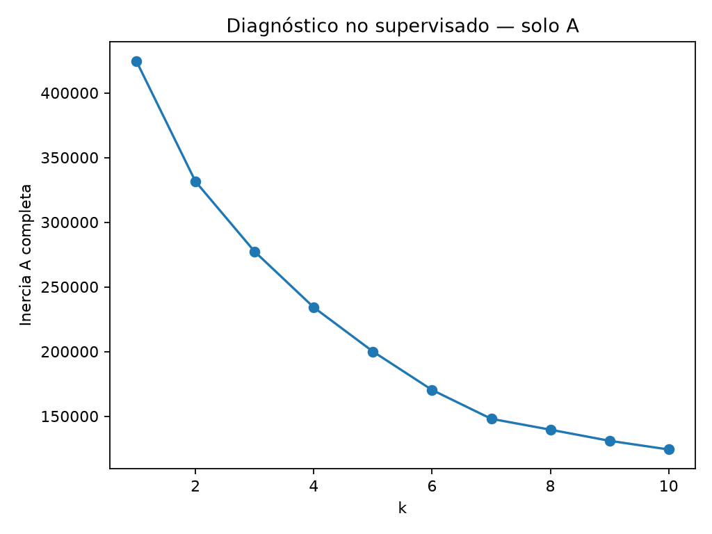
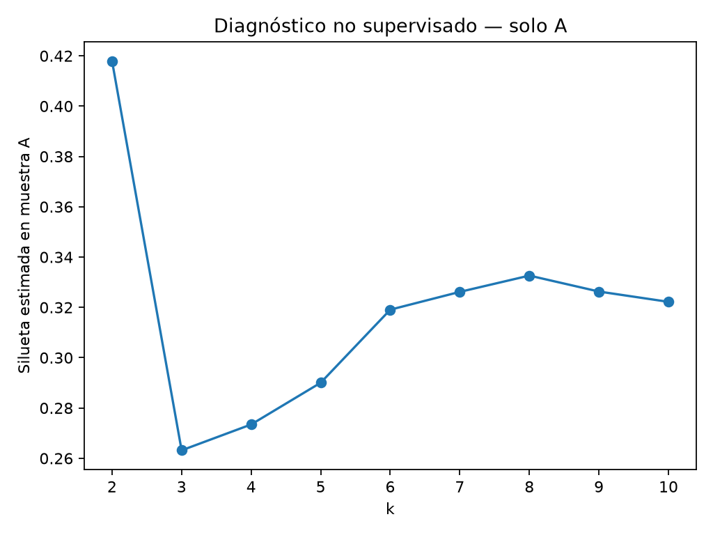
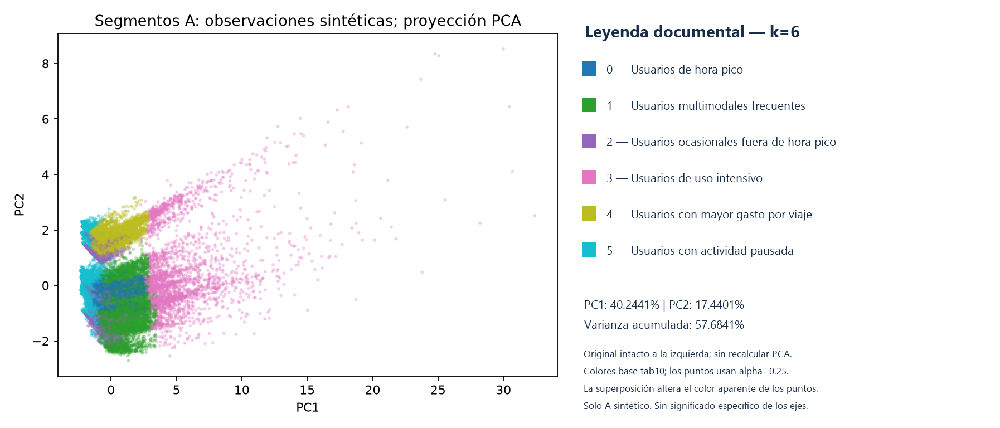
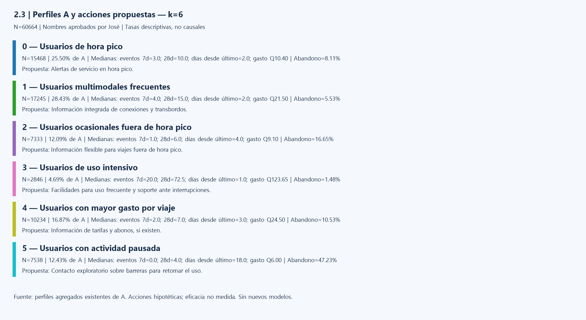

# Cierre de Fase 2.3 — KMeans y PCA sobre A

Responsable: José. Documento preparado para su revisión antes de staging.
Diagnóstico y segmentación ya ejecutados; este cierre utiliza exclusivamente sus
reportes agregados. No se repiten modelos ni se leen observaciones A/B. La Fase 2.4
corresponde a Paolo y queda fuera de este trabajo.

## Objetivo, fuente y procesamiento

Describir segmentos de comportamiento del corte A (2026-07-01), N=60,664,
mediante KMeans sobre características escaladas y visualizarlos con PCA 2D.
Se emplean exactamente estas siete variables, en este orden:

1. `eventos_ultimos_7_dias`
2. `eventos_ultimos_28_dias`
3. `cantidad_modos_distintos`
4. `dias_desde_ultimo_evento`
5. `proporcion_eventos_hora_pico`
6. `gasto_acumulado_gtq`
7. `gasto_promedio_evento_gtq`

Conversión numérica, imputación por mediana y StandardScaler ajustados solo con A.
Esto evita que unidades de gasto y frecuencia dominen por su escala, pero no elimina
asimetrías, extremos ni dependencia entre variables. Las medianas de perfiles son
originales, no valores estandarizados; omiten nulos por variable.

`modo_mas_usado` y `zona_origen_mas_frecuente` quedan reservadas para caracterización
posterior, no para distancia: codificación y cardinalidad podrían cambiar la geometría
euclídea. No se afirma que se haya realizado una caracterización categórica aquí.
Se excluyen etiqueta, identificadores, tarjetas, fechas y columnas adicionales.
KMeans utiliza k-means++, n_init=10, random_state=42 y algorithm=lloyd.

## Elección de k antes de examinar abandono

Se evaluó k=2..10; k=1 es solo referencia de inercia, sin silueta. La inercia usa
A completa; la silueta estima separación en la misma muestra uniforme fija de
3,000, sin reposición y semilla 42. El cálculo por bloques limita memoria de trabajo
a 64 MiB. Todos los clusters tuvieron al menos dos representantes; esto no garantiza
precisión suficiente en grupos pequeños. El diagnóstico no cargó abandono.

| k | Inercia A | Silueta muestral | Mínimo en muestra | Máximo en muestra |
|---:|---:|---:|---:|---:|
| 1 | 424648.00 | No definida | — | — |
| 2 | 331450.16 | 0.417921 | 303 | 2697 |
| 3 | 277266.30 | 0.263169 | 238 | 2119 |
| 4 | 234101.08 | 0.273451 | 180 | 1135 |
| 5 | 199977.73 | 0.290053 | 149 | 964 |
| 6 | 170252.44 | 0.319089 | 146 | 889 |
| 7 | 147955.08 | 0.326163 | 32 | 794 |
| 8 | 139545.64 | 0.332638 | 31 | 772 |
| 9 | 130942.65 | 0.326296 | 6 | 728 |
| 10 | 124227.26 | 0.322204 | 6 | 714 |

Estos mínimos/máximos son **muestrales**, no tamaños de clusters de A completa.
No hay advertencias numéricas registradas para k=2..10.

El codo es cercano a 7: la reducción de inercia de 6 a 7 es 22,297.36 (13.10%)
y de 7 a 8 baja a 8,409.44 (5.68%). La mejor silueta es k=2; entre soluciones
más detalladas el máximo local aparece en k=8. No hay un único óptimo indiscutible.

**Decisión aprobada: k=6**, antes de examinar etiquetas, como compromiso entre codo,
silueta, representación muestral e interpretabilidad. Ofrece más detalle que k=2
y evita la representación pequeña observada desde k=7. No maximiza silueta ni es
un óptimo matemático demostrado. Las tasas de abandono no justifican esta decisión.

Fuentes: [resumen diagnóstico](../../reportes_fase2_3/diagnostico_k/resumen.json) y
[tabla k](../../reportes_fase2_3/diagnostico_k/diagnostico_k.csv).

## PCA y leyenda documental

| Componente | Varianza explicada |
|---|---:|
| PC1 | 40.2441% |
| PC2 | 17.4401% |
| Acumulada | 57.6841% |
| Fuera del plano | 42.3159% |

PCA se aplicó al mismo espacio numérico escalado únicamente para visualizar.
KMeans se ajustó en las siete dimensiones, no en PC1/PC2. Hay solapamiento central,
bandas y puntos alejados; el plano no prueba separación perfecta ni estabilidad.
No se registraron cargas PCA: no se atribuye significado específico a los ejes.

La imagen anterior conserva la gráfica existente sin reubicar puntos ni recalcular
coordenadas y añade únicamente un margen de leyenda. Se conserva también una
[copia exacta del PNG original](../../evidencias/Fase_2/fase2_3/03_pca_2d.original.png).

La correspondencia se deriva del código registrado: `scatter(c=labels, cmap='tab10',
alpha=0.25)`, sin normalización explícita, y seis IDs presentes de 0 a 5. La
normalización lineal 0..5 consulta tab10 en 0, 0.2, 0.4, 0.6, 0.8 y 1; esto selecciona
los índices de paleta 0, 2, 4, 6, 8 y 9. Se contrastó con la definición local de tab10.

| ID | Color base |
|---:|---|
| 0 | Azul `#1f77b4` |
| 1 | Verde `#2ca02c` |
| 2 | Violeta `#9467bd` |
| 3 | Rosa `#e377c2` |
| 4 | Oliva `#bcbd22` |
| 5 | Cian `#17becf` |

La leyenda muestra colores base opacos: transparencia y superposición alteran el
color visible de los puntos. Los IDs son etiquetas arbitrarias, no niveles ordinales.

## Perfiles reales y nombres aprobados por José

Los nombres son interpretación documental posterior, no modificaciones del ajuste.
Los reportes originales conservan los nombres provisionales por trazabilidad.

| ID | Nombre aprobado | N | % A | Eventos 7d | Eventos 28d | Días desde último | Gasto acumulado Q | Abandono |
|---:|---|---:|---:|---:|---:|---:|---:|---:|
| 0 | Usuarios de hora pico | 15468 | 25.50% | 3 | 10 | 2 | 10.40 | 8.11% |
| 1 | Usuarios multimodales frecuentes | 17245 | 28.43% | 4 | 15 | 2 | 21.50 | 5.53% |
| 2 | Usuarios ocasionales fuera de hora pico | 7333 | 12.09% | 1 | 6 | 4 | 9.10 | 16.65% |
| 3 | Usuarios de uso intensivo | 2846 | 4.69% | 20 | 72.5 | 1 | 123.65 | 1.48% |
| 4 | Usuarios con mayor gasto por viaje | 10234 | 16.87% | 2 | 7 | 3 | 24.50 | 10.53% |
| 5 | Usuarios con actividad pausada | 7538 | 12.43% | 0 | 4 | 18 | 6.00 | 47.23% |

Las columnas de comportamiento anteriores son medianas. Los tamaños suman 60,664
y los porcentajes sin redondear 100%; los porcentajes mostrados pueden sumar 100.01%
por redondeo. Las tasas ponderadas reconcilian 8,110 positivos de A.

| ID | Mediana modos distintos | Mediana proporción pico | Mediana gasto por evento Q |
|---:|---:|---:|---:|
| 0 | 1 | 94.74% | 1.00 |
| 1 | 2 | 90.91% | 1.33 |
| 2 | 1 | 0.00% | 1.30 |
| 3 | 2 | 72.65% | 1.40 |
| 4 | 1 | 98.84% | 3.50 |
| 5 | 1 | 100.00% | 1.30 |

El nombre del segmento 4 usa «viaje» como denominación aprobada; la variable medida
es gasto por **evento**, no necesariamente un viaje completo con transbordos.
Los nombres no describen a cada persona ni permiten inferir ocupación o ingreso.
Las medianas se calculan por variable y no forman una observación individual real.

## Interpretación y acciones propuestas

| ID | Fundamento observado | Propuesta diferenciada, eficacia no medida |
|---:|---|---|
| 0 | Uso reciente y concentración pico 94.74%. | Alertas de continuidad y cambios de servicio en horas pico. |
| 1 | 15 eventos en 28 días y mediana de dos modos. | Información integrada de conexiones y transbordos para facilitar continuidad. |
| 2 | Baja frecuencia y mediana de proporción pico cero. | Información flexible de disponibilidad fuera de hora pico, sin presumir horario laboral. |
| 3 | 20 eventos en 7 días, 72.5 en 28 y gasto acumulado Q123.65. | Facilidades para uso frecuente y soporte ante interrupciones; abonos solo si existen. |
| 4 | Gasto por evento Q3.50, superior al resto, con frecuencia moderada. | Información transparente de tarifas y alternativas disponibles; no inferir sensibilidad al precio. |
| 5 | Cero eventos en 7 días y 18 días desde el último. | Contacto exploratorio sobre barreras para retomar uso, sin presumir intención de abandono. |

El segmento 5 tiene mayor tasa observada de abandono, 47.23%; el 3 la menor,
1.48%. Son asociaciones descriptivas posteriores a fijar k, no efectos causales
ni probabilidades individuales. Las acciones son hipótesis de retención: no se han
medido campañas, beneficios ni respuestas. No se aplica automáticamente la política
individual de contacto de 2.2 a partir de estas tasas grupales.

El menor segmento final es el 3: 2,846 personas (4.69%), sin grupos diminutos en
esta solución. Su intensidad aconseja cautela ante extremos. La tabla no permite
conocer dispersión interna, estabilidad ni causas de las diferencias.

## Alcance, auditoría y rúbrica

La fuente A es sintética y tiene limitaciones de procedencia/completitud previamente
documentadas. El escalado no elimina extremos ni el peso repetido de variables
correlacionadas. La silueta es muestral, sin intervalos de incertidumbre registrados.
El gráfico pierde 42.3159% de varianza; ningún eje recibe interpretación causal.

**El clasificador congelado de 2.2 no usa el segmento como feature y no se modificó.**
B no se consultó para elegir k ni para este cierre. Si en otro diseño se añadiera
el segmento al clasificador, imputación, escalado y KMeans deberían ajustarse dentro
de cada fold; esa integración no forma parte del trabajo presente.

Diagnóstico registrado: 2026-11-11T23:10:35.501976+00:00. Segmentación final registrada:
2026-11-11T23:34:45.457877+00:00. Son fechas de metadatos generados antes de completar
cada cálculo, no marcas exactas de finalización. Ambos reportan HEAD
`921dede19e8de703de7c1237aa25aeb89cff8b9f`; el script era nuevo y aún no estaba
versionado en ese HEAD. Su SHA256 registrado y cotejado es
`5cb4c50239d20511edcf058e04f34a3e9beef8337a93533df51d8370a7cbefce`.
Un futuro commit documental no sustituye estas referencias de ejecución.

Fuentes agregadas preservadas: [resumen final](../../reportes_fase2_3/segmentacion_k6/resumen.json)
y [perfiles originales](../../reportes_fase2_3/segmentacion_k6/perfiles.csv).
Las copias exactas de codo, silueta y PCA se cotejaron por SHA256. La versión con
leyenda y la lámina de acciones son derivados documentales, no nuevos resultados.
No se publican CSV de observaciones, asignaciones individuales, coordenadas tabuladas,
identificadores, predicciones ni material privado del test B. El PCA reproduce
únicamente la visualización sintética existente sin IDs ni tooltips.

| Rúbrica 2.3 | Evidencia reunida |
|---|---|
| KMeans con features escaladas A | Configuración, siete variables, mediana y StandardScaler. |
| Elección k por codo/silueta | Tabla y dos gráficas; compromiso k=6 justificado sin etiqueta. |
| PCA 2D y varianza explicada | Gráfica con leyenda documental y porcentajes PC1/PC2/acumulada. |
| Nombre, tamaño y medianas por segmento | Seis nombres aprobados y tablas verificadas. |
| Tasa de abandono descriptiva | Tasas agregadas, sin causalidad ni selección retroactiva. |
| Acciones distintas para >=2 segmentos | Seis propuestas fundamentadas, no campañas evaluadas. |
| Prevención de fuga si segmento fuera predictor | Integración no realizada; condición por fold documentada. |

Las 14 pruebas sintéticas aprobadas corresponden a la implementación previa; no
se repitieron en este cierre. Resta revisión de José y posterior staging/commit,
sin afirmar aprobación docente ni puntuación académica.
